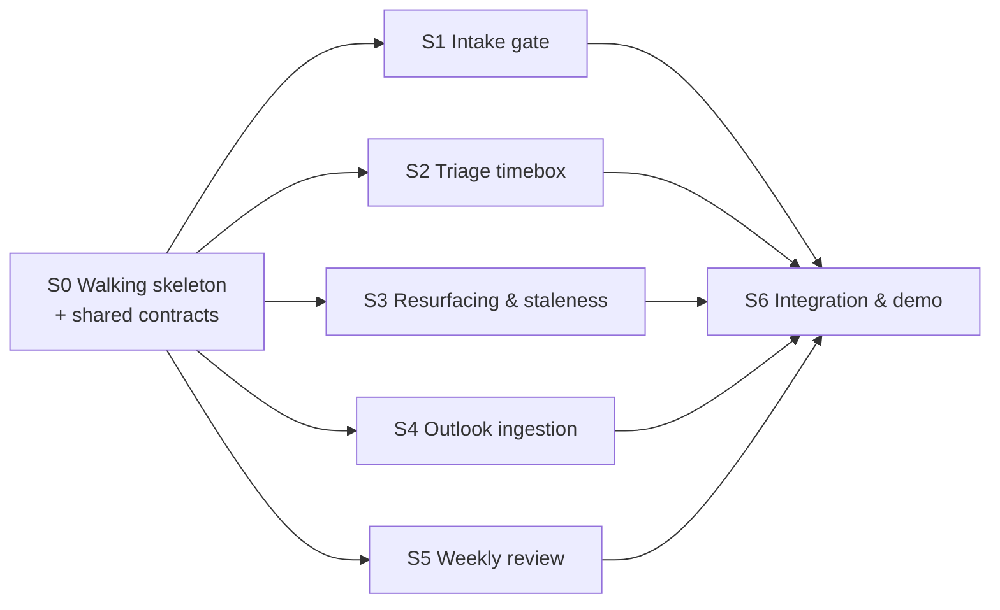

# TaskBot — Product Requirements Document (MVP)

_Version 1.0 · 2026-11-20 · Status: ready for build_
_Design rationale lives in [SPEC.md](SPEC.md). This PRD is the build contract. Where they disagree, the PRD wins._

---

## 1. Overview

**Problem.** An engineer carrying both on-call and project load gets ad-hoc tasks and incidents that *feel* urgent. Their size is unknown up front, and many commenters add noise. Interrupt work crowds out planned work, even though much of it could have waited.

**Product.** A personal, local web app that:

1. Forces a deliberate decision on every new ad-hoc item, using an LLM to summarize the item and suggest a decision.
2. Brings deferred work back at the right time.
3. Proves, with data, how much "urgent" work could have waited.

**User.** One person (the owner), on their own Windows machine. Nobody else uses or sees the app.

### Goals
- G1: No ad-hoc item gets worked on before it has an explicit outcome (incidents are logged afterwards).
- G2: Replace noisy threads with a one-glance **ask card**.
- G3: Make "this could have waited" measurable: staleness closures and the override log.

### Non-goals (MVP)
Team use, Slack, PagerDuty/Jira, capacity budgets, time tracking, global hotkey, native Windows notifications, sending or modifying email, and running anywhere other than localhost.

### Success metrics (after 4 weeks of use)
| Metric | Target |
|---|---|
| Ad-hoc items decided before work started | ≥ 90% |
| Interrupt items deferred/declined/closed-stale with no requester follow-up | Reported weekly (baseline; no target yet) |
| Overrides with a reason | 100% (enforced) |
| Recurring patterns surfaced by override log | ≥ 1 actionable pattern |

---

## 2. Glossary

| Term | Meaning |
|---|---|
| **Item** | One unit of work in TaskBot. It comes from manual capture or email. |
| **Tray** | The queue of items waiting for an intake decision |
| **Intake gate** | The flow that turns a tray item into a decided item |
| **Ask card** | The LLM summary: request, requester, deadline, open questions, pressure count |
| **Outcome** | `do_now` · `timebox` · `schedule` · `delegate` · `decline` |
| **Work type** | `incident` · `interrupt` · `toil` · `planned` |
| **Staleness closure** | A deferred item closed because nobody followed up within 5 working days |
| **Working day** | Monday to Friday. Holidays are ignored in the MVP. |

---

## 3. Slicing strategy

The build is split into **vertical slices**. Each slice delivers one feature you can see and use, from the database through to the dashboard, and **owns its own files**, so separate Claude agents can build slices in parallel without editing the same files.



| Slice | What the user can do when it's done | Depends on | Parallel? |
|---|---|---|---|
| **S0** Walking skeleton | Type a task into quick-add and see it appear in the tray | — | Must finish first; one agent |
| **S1** Intake gate | Open a tray item, read its ask card, answer the four questions, see the AI suggestion, then accept or override | S0 | ✅ |
| **S2** Triage timebox | Timebox an item, get a browser notification when time is up, and re-assess it | S0 | ✅ |
| **S3** Resurfacing & staleness | Scheduled items come back on their date, and silent deferred items are offered for closure | S0 | ✅ |
| **S4** Outlook ingestion | Incoming mail is read, sorted, and "needs action" emails show up in the tray | S0 | ✅ |
| **S5** Weekly review | See the week's mix, staleness closures, and override patterns | S0 | ✅ |
| **S6** Integration & demo | Run the whole flow end-to-end on real mail | S1–S5 | Last; one agent |

**Why S1–S5 can run in parallel.**
- Slices never call each other's code. They share only:
  - the **database schema**
  - the **item event log**
  - the **core services** that S0 freezes
- Each slice tests with items placed straight into the database, so S2, S3 and S5 don't need S1's UI to exist.

---

## 4. Shared contracts (built and frozen in S0)

Every agent must read this section before starting. After S0 merges, **`taskbot/core/` is frozen**. A slice that needs a core change makes only an *additive* change (a new function or column, never a rename or removal) and lists it in its PR description.

### 4.1 Repository layout

```
taskbot/
  core/
    config.py      # loads .env; settings() + get(name)
    clock.py       # now()/now_iso(); set_now() freezes time in tests
    db.py          # SQLite connection + migrations runner
    models.py      # enums, state machine, Item/Event dataclasses
    items.py       # item repository + transition() + log_event()
    llm.py         # complete_json(); fake mode; `python -m taskbot.core.llm` smoke test
    scheduler.py   # register_job(name, every_seconds, fn)
    app.py         # FastAPI app, discovers + mounts slices, serves the dashboard
    routes.py      # /api/core: health, panels, quick-add, item reads
  slices/
    README.md      # practical guide for slice authors (read this)
    s1_intake/     __init__.py  router.py  service.py  prompts.py  static/{panel.json,panel.js}  tests/
    s2_timebox/    ...
    s3_resurface/  ...
    s4_outlook/    ...
    s5_review/     ...
  static/
    index.html, app.js, style.css   # dashboard shell
    panels.json    # core panels only (tray)
    panels/tray.js # quick-add + tray list
migrations/
  0001_core.sql    # S0
  01xx_<slice>.sql # one numbered range per slice: s1=0100s, s2=0200s, ...
tests/fixtures/    # shared seed helpers
conftest.py        # shared fixtures: fresh DB, fake LLM/mail, scheduler off; `client`
.env.example       # documented keys; real .env is git-ignored
```

**Slice wiring (automatic, no core edits needed):**
- A slice's `router.py` must define `router = APIRouter()` and may define `startup()`.
- The router is mounted at `/api/<folder>`.
- `startup()` runs once after migrations. Register background jobs there.
- `static/` is served at `/slices/<folder>/`.
- `static/panel.json` holds the slice's dashboard panel entries, as one object or a list. Each entry has `title`, `module` and `order`.

**Ownership rule:** an agent edits only its own `slices/sN_*/` folder (including its `panel.json`) and its own migration number range.

### 4.2 Configuration (`.env`)

| Key | Purpose | Default |
|---|---|---|
| `OPENCODE_API_KEY` | OpenCode Zen key | required unless `TASKBOT_LLM=fake` |
| `OPENCODE_BASE_URL` | LLM endpoint (chat completions, per `https://opencode.ai/zen/v1/models`) | `https://opencode.ai/inference/openai/v1` |
| `OPENCODE_MODEL` | Main model (ask card, suggestion) | owner sets |
| `OPENCODE_MODEL_CHEAP` | Email classification model | same as above |
| `TASKBOT_LLM` | `real` or `fake` | `real` |
| `TASKBOT_MAIL` | `mcp` or `fake` | `mcp` |
| `TASKBOT_MAIL_MCP_COMMAND` | Command that launches the Outlook MCP server (S4) | `npx -y @softeria/ms-365-mcp-server --preset mail` |
| `TASKBOT_PORT` | Dashboard port (`--port` overrides) | `8765` |
| `TASKBOT_DB` | SQLite path | `./taskbot.db` |
| `TASKBOT_SCHEDULER` | `on` / `off` background jobs | `on` |
| `TASKBOT_DEBUG` | `1` logs LLM prompts and responses | `0` |

### 4.3 Core data model (`0001_core.sql`)

```
items(
  id INTEGER PK, title TEXT, source TEXT CHECK(source IN ('manual','email')),
  source_ref TEXT NULL,            -- email conversation id
  raw_context TEXT,                -- pasted thread / email body
  ask_card_json TEXT NULL,         -- see §4.4
  pressure_count INTEGER DEFAULT 0,
  type TEXT NULL,                  -- incident|interrupt|toil|planned
  status TEXT NOT NULL,            -- see state machine
  outcome TEXT NULL,               -- do_now|timebox|schedule|delegate|decline
  priority INTEGER NULL,           -- 1 (highest) .. 4
  timebox_end TEXT NULL, scheduled_for TEXT NULL, delegated_to TEXT NULL,
  last_external_activity TEXT NULL,
  created_at TEXT, decided_at TEXT NULL, closed_at TEXT NULL
)
item_events(
  id INTEGER PK, item_id INTEGER, kind TEXT, payload_json TEXT, at TEXT
)
```

**Item states (`transition()` rejects anything not listed below).**

| From | Can move to |
|---|---|
| (new item) | `tray` |
| `tray` | `active`, `timeboxed`, `scheduled`, `delegated`, `declined` |
| `timeboxed` | `tray` (re-assess when the timer ends) |
| `scheduled` | `tray` (resurfaces on its date), `closed_stale` |
| `active` | `done` |
| `delegated` | `done`, `closed_stale` |

Each state change writes an `item_events` row with kind `status_changed`.

**Event kinds** (S5 reads these; producers must emit them):

| Kind | Payload | Emitted by |
|---|---|---|
| `created` | `{source}` | S0 / S4 |
| `status_changed` | `{from, to}` | core `transition()` |
| `suggested` | `{outcome, type, priority, rationale}` | S1 |
| `decided` | `{outcome, type, accepted: bool, override_reason?}` | S1 |
| `timebox_expired` | `{}` | S2 |
| `resurfaced` | `{}` | S3 |
| `external_activity` | `{via: 'email'}` | S4 |
| `stale_suggested` / `closed_stale` | `{silent_days}` | S3 |
| `classification_corrected` | `{from, to}` | S4 |

### 4.4 Ask card JSON (written by S1; S4 may pre-fill)

```json
{ "request": "one sentence", "requester": "name/email",
  "deadline": "2026-11-25 | null", "deadline_kind": "real|felt|none",
  "open_questions": ["..."] }
```

### 4.5 LLM client (`core/llm.py`)

```python
complete_json(system: str, user: str, schema: dict, model: str | None = None) -> dict
```
- Talks to the OpenAI-compatible endpoint and validates the response against `schema`.
- Retries once, then raises `LLMError`.
- **Fake mode** (`TASKBOT_LLM=fake`) returns a deterministic value from `schema`'s `examples`, so every slice can be built and tested without an API key or network.

### 4.6 Scheduler (`core/scheduler.py`)
`register_job(name, every_seconds, fn)`: a single asyncio loop inside the app process. Jobs must be idempotent.

### 4.7 Dashboard shell
- `index.html` fetches `/api/core/panels`, which merges the core `panels.json` with every slice's `panel.json` and sorts them by `order`. It loads each panel as an ES module.
- Panel orders: tray 10, S1 20, S2 30, S3 40–45, S4 50, S5 60.
- Each panel exports `mount(el, api)`. `api` provides:
  - `get/post/put/patch/del`: a thin `fetch` wrapper around `/api/...`
  - `on(type, fn)` / `emit(type, detail)`: an in-page event bus
  - `notify(title, body)`: a browser notification plus a toast
  - `toast(msg, kind)`
  - `h(tag, attrs, ...children)`: safe DOM building
  - `timeAgo(iso)`
- **Shared UI events:**
  - `items:changed`: emit it after creating or changing items, so the other panels refresh.
  - `item:open {id}`: the tray emits it when an item is clicked. **S1 listens** and opens the intake gate.
- Slice API routes live under `/api/<slice>/...`.
- No frontend framework or build step. Never put untrusted text (email, threads) into `innerHTML`.
- Browser notifications go through `api.notify(title, body)`. The shell asks for notification permission once.

### 4.8 Time
- Use `core.clock.now()` / `now_iso()`, never `datetime.now()`, so tests can freeze time.
- Timestamps are UTC ISO-8601 strings with offset. Date-only fields such as `scheduled_for` are `YYYY-MM-DD`.

### 4.9 Core API (`core/items.py`)
- `create_item(title, source, *, raw_context, source_ref, **columns)`: creates the item in `tray` and logs `created`.
- `get_item(id)` and `list_items(status, *, source, source_ref, limit, newest_first)`.
- `update_fields(id, **columns)`: sets any column except `id`, `status` and `created_at`. It accepts `ask_card=dict`. Columns added by slices are allowed, and are exposed as `item.extra[...]`.
- `transition(id, to, **columns)`:
  - validates against the state table and raises `InvalidTransition` for anything else
  - writes `status_changed`
  - sets `closed_at` when the item enters a terminal state
- `log_event(id, kind, payload)` and `list_events(*, item_id, kinds, since, until)`.
- Every function accepts `conn=` so several calls can run in one transaction.

---

## 5. Slice requirements

Each slice lists its user story, its requirements (`FR-xx`), the files it owns, its acceptance criteria (`AC`), and a demo script. A slice is **done** when:
- all of its acceptance criteria pass as automated tests in fake mode, and
- its demo script works by hand.

### S0 — Walking skeleton + contracts

**Story:** As the owner, I can start TaskBot with one command, add a task from the dashboard, and see it in the tray.

| ID | Requirement |
|---|---|
| FR-01 | `python -m taskbot` starts the server on `TASKBOT_PORT` and opens no external ports (binds to `127.0.0.1`) |
| FR-02 | Migrations run automatically on start, in order, and only once each |
| FR-03 | Quick-add box: a title plus an optional pasted thread creates an item with `source=manual`, `status=tray` and a `created` event |
| FR-04 | The tray panel lists tray items, newest first |
| FR-05 | All of §4 is implemented: config, clock, db, models, items/transition/log_event, llm (real + fake), scheduler, slice discovery, and the dashboard shell with its panel registry and event bus |
| FR-06 | `git init`, `.gitignore` (`.env`, `*.db`, `.venv`), `.env.example`, a `README` with run and test commands, and `pytest` set up |
| FR-07 | `tests/fixtures`: `seed_item(**overrides)` and `seed_event(...)` helpers for the other slices |

**Owns:** everything outside `taskbot/slices/`.
**AC:**
1. On a fresh clone with `TASKBOT_LLM=fake`, the app starts and a quick-add item appears in the tray.
2. `transition()` raises an error for a move the state table doesn't allow, and writes a `status_changed` event for an allowed one.
3. `complete_json` in fake mode returns data that matches the schema.

**Demo:** Start the app, add "Check disk alert on db-3", and see it in the tray.

---

### S1 — Intake gate

**Story:** As the owner, when I open a tray item I see a short ask card, the four questions already filled in, and an AI suggestion with its reasoning and a solution sketch. I accept the suggestion, or override it with a reason.

| ID | Requirement |
|---|---|
| FR-10 | Opening a tray item makes **one** LLM call that returns: ask card, pressure count, pre-filled answers to the 4 intake questions, suggested type, outcome, priority, rationale (≤ 3 sentences), and solution sketch (first steps, questions to ask the requester, or a draft reply) |
| FR-11 | The four questions are editable: cost of delay (`none/minor/significant`), deadline real or felt, blocked count, and whether someone else could do it. Editing any answer offers a **re-suggest** button. |
| FR-12 | The raw thread is collapsed by default and opens on click |
| FR-13 | Guardrails apply after the LLM and override its suggestion. An item typed `incident` with production impact gets outcome `do_now`. An item whose size is unknown gets outcome `timebox`. The UI marks the suggestion as "rule-adjusted" when a guardrail changes it. |
| FR-14 | Accepting writes a `decided` event with `accepted=true` and moves the item to its target state |
| FR-15 | Overriding requires a non-empty one-line reason (the button stays disabled without one) and writes a `decided` event with `accepted=false` plus the reason |
| FR-16 | Each outcome needs extra input: `timebox` needs minutes (default 30), `schedule` needs a date, `delegate` needs a person's name |
| FR-17 | **Incident fast path:** an "Incident — log after" button skips the gate, sets `do_now` and type `incident`, and asks for the ask card and questions after the work is done |
| FR-18 | **LLM failure:** the gate still works manually, with empty answers, no suggestion, and a visible error |
| FR-19 | The context sent to the LLM includes the titles of the owner's current `active`, `timeboxed` and `scheduled` items, so suggestions take existing commitments into account |

**Owns:** `slices/s1_intake/`, migrations `0100s`.
**AC:**
1. In fake mode, opening a seeded tray item shows the ask card and a suggestion.
2. Override is impossible without a reason.
3. An incident with production impact is always suggested as `do_now`.
4. Every decision produces the correct state change and a `decided` event.
5. With the LLM forced to fail, the manual decision path still works.

**Demo:** Paste a 15-message thread that includes "+1" pings. The ask card shows one request sentence and a pressure count above zero. Accept a "Schedule" suggestion and the item leaves the tray.

---

### S2 — Triage timebox

**Story:** When I timebox an item, I see a countdown. When it ends, I'm notified and must re-assess the item with what I learned.

| ID | Requirement |
|---|---|
| FR-20 | Timeboxed items appear in a "Timeboxes" panel with a live countdown |
| FR-21 | A scheduler job (every 30 s) moves items whose timebox has ended back to `tray`, emits `timebox_expired`, and flags them `reassess=true` |
| FR-22 | The browser notification "Timebox up: <title>" fires once per expiry while the dashboard is open. If the dashboard is closed, a banner shows the next time it's opened. |
| FR-23 | When an item flagged for re-assessment opens in the tray, a "What did you learn?" note is required before deciding, and the note is passed to the LLM as extra context. S2 provides this through a hook S1 reads: the `reassess_note` column plus a `GET /api/s2_timebox/note/{id}` endpoint. |
| FR-24 | Extend timebox: one click adds 15 min. Each extension is logged. |

**Owns:** `slices/s2_timebox/`, migrations `0200s`.
**AC:**
1. A seeded item whose timebox has already ended is back in the tray, flagged for re-assessment, after one job tick.
2. The expiry event fires exactly once.
3. The countdown is correct to within one second of server time.

**Demo:** Timebox an item for 1 minute, wait for the notification, and see it back in the tray marked "Re-assess".

---

### S3 — Resurfacing & staleness

**Story:** Scheduled items come back on their date. If something I deferred got no follow-up for 5 working days, TaskBot offers to close it as "not actually needed."

| ID | Requirement |
|---|---|
| FR-30 | A daily job, also run on startup, moves `scheduled` items whose `scheduled_for` date has arrived to `tray` and emits `resurfaced` |
| FR-31 | The "Resurfacing today" panel lists items resurfaced today |
| FR-32 | **Staleness:** a `scheduled` or `delegated` item becomes a staleness candidate when there have been ≥ 5 working days since the later of `decided_at` and `last_external_activity`. This emits `stale_suggested` once. |
| FR-33 | The "Probably not needed" panel lists candidates with **Close as stale** and **Keep** buttons. Close moves the item to `closed_stale` and emits `closed_stale`. Keep resets the clock. |
| FR-34 | `working_days_between(a, b)` is a pure function with unit tests, Monday to Friday only |

**Owns:** `slices/s3_resurface/`, migrations `0300s`.
**AC:**
1. A seeded item scheduled for yesterday resurfaces.
2. An item decided 7 calendar days ago (spanning a weekend, so 5 working days) with no activity becomes a candidate. One that had activity 2 days ago doesn't.
3. Close and Keep behave as specified.

**Demo:** Seed a stale deferred item, see it in "Probably not needed", and close it.

---

### S4 — Outlook ingestion

**Story:** TaskBot reads my Outlook mail and sorts each message. Only emails that need action from me show up in my tray. I can correct a wrong classification with one click.

| ID | Requirement |
|---|---|
| FR-40 | MCP client (Python `mcp` SDK, stdio) launches the Outlook MCP server via `npx`. Candidate: `@softeria/ms-365-mcp-server`, mail tools only, read-only mode if it has one. The command is set in `.env`, so the server can be swapped. |
| FR-41 | **Read-only enforcement:** an allowlist of tool names (list/get/search only). Any other tool call raises an error before it is sent. |
| FR-42 | First-run sign-in: the server's device-code prompt (URL + code) is shown on the dashboard. The app doesn't crash while waiting for sign-in. |
| FR-43 | Polling job every 5 min, plus a manual "Sync now" button. Messages are deduplicated by message id and stored in `emails(id, conversation_id, from, subject, received_at, body_preview, classification, user_corrected)`. |
| FR-44 | Each new message is classified with the cheap model as `needs_action` / `fyi` / `noise`. The prompt includes the last 10 user corrections as examples. |
| FR-45 | A `needs_action` message creates an item: `source=email`, `source_ref=conversation_id`, `type=interrupt` (proposed), `status=tray`, title = subject. If that conversation already has an **open** item, the message instead adds to `pressure_count`, updates `last_external_activity`, and emits `external_activity` (this is what keeps S3's staleness clock accurate). |
| FR-46 | The "Mail" panel shows classification counts and the latest FYI/noise messages, each with **This needs action** / **Not actionable** correction buttons. A correction emits `classification_corrected` and creates or archives the matching item. |
| FR-47 | Email never triggers a browser notification |
| FR-48 | **Fake mode** (`TASKBOT_MAIL=fake`) reads messages from `tests/fixtures/mail/*.json` |

**Owns:** `slices/s4_outlook/`, migrations `0400s`.
**AC:**
1. In fake mode, fixtures sort into the three classes, and only `needs_action` messages become tray items.
2. A reply in an open item's conversation bumps its pressure count instead of creating a duplicate item.
3. A tool not on the allowlist is rejected.
4. Correcting a message's classification creates or archives the item as expected.

**Demo:** Sync with real Outlook. An email asking you for something lands in the tray, and newsletters don't.

---

### S5 — Weekly review

**Story:** Every week I can see where my attention went and how much "urgent" work turned out not to matter.

| ID | Requirement |
|---|---|
| FR-50 | Week selector (Monday to Sunday). The default is the current week. |
| FR-51 | Items decided this week, broken down by type and by outcome (counts) |
| FR-52 | Staleness closures this week, plus items declined with no requester follow-up afterwards. The latter is labelled "Could have waited". |
| FR-53 | Override log: each override with its reason, plus a grouping of overrides by requester and by reason keyword. A requester or keyword that appears more than twice is highlighted. |
| FR-54 | Acceptance rate of AI suggestions |
| FR-55 | Computed **only** from `items` and `item_events`; no other slice's tables are read |

**Owns:** `slices/s5_review/`, migrations `0500s`.
**AC:**
1. Seeded events for a known week produce the expected counts.
2. A requester with 3 overrides is highlighted.
3. The review renders without errors for an empty week.

**Demo:** Seed a week of events and walk through the review.

---

### S6 — Integration & demo

**Story:** The whole flow works end-to-end, on real mail and the real LLM.

| ID | Requirement |
|---|---|
| FR-60 | Merge all slices and check that the panels appear in this order (set by each slice's `panel.json` `order` value): Tray, Intake, Timeboxes, Resurfacing, Probably not needed, Mail, Review |
| FR-61 | Connect S1 to S2's re-assess hook (FR-23) and to S4's pre-filled requester (FR-45) |
| FR-62 | End-to-end test in fake mode: email → tray → gate → timebox → expiry → re-assess → schedule → resurface → stale close → appears in review |
| FR-63 | Smoke test on the real stack: real OpenCode key and real Outlook sign-in. Record whatever breaks. |
| FR-64 | `README` demo script, 5 minutes long |

**AC:** The end-to-end test passes, and the smoke test checklist is completed with its results written down.

---

## 6. Non-functional requirements

| ID | Requirement |
|---|---|
| NFR-1 | **Local only.** Binds to `127.0.0.1`. The only outbound traffic goes to the OpenCode API and Microsoft (through the MCP server). |
| NFR-2 | **Mail is read-only** (FR-41). TaskBot never sends, moves, flags or deletes mail. |
| NFR-3 | **Secrets** live only in `.env`, which is git-ignored. Keys are never logged. LLM prompts and responses are logged only when `TASKBOT_DEBUG=1`. |
| NFR-4 | **Degrades gracefully.** If the LLM or mail is down, manual capture and decisions still work, and the dashboard shows the outage. |
| NFR-5 | **Latency.** The ask card and suggestion appear in ≤ 15 s (p90). The dashboard loads in ≤ 1 s. |
| NFR-6 | **Testability.** Every slice's tests pass with `TASKBOT_LLM=fake TASKBOT_MAIL=fake` and no network. |
| NFR-7 | **Stack:** Python 3.13, FastAPI, uvicorn, `openai`, `mcp`, `pydantic`, `pytest`. No frontend build step. |

---

## 7. Agent working agreement

1. **Order:** S0 is built first and merged by one agent. Then S1–S5 are built in parallel, one agent per slice, each in its own git worktree or branch. S6 goes last.
2. **Read first:** §4 (contracts) and your own slice's section. Don't read other slices' code. Rely on the contracts.
3. **Stay in your lane:** only edit the files your slice owns (§4.1). Changes to `core/` must be additive and listed in the PR.
4. **Test without network:** use fake mode. Seed data with `tests/fixtures` instead of depending on another slice's UI.
5. **Done means:** every AC passes as a test, the demo script has been run by hand, and the PR notes any contract additions.

---

## 8. Risks & open items

| Risk | Mitigation |
|---|---|
| The Microsoft 365 tenant requires admin approval for the MCP server's app | Discover this early: do the S4 sign-in spike on day one. Fall back to a different MCP server or the owner's own app registration. |
| The chosen MCP server's tool names or read-only flag differ from expectations | The allowlist (FR-41) is configured, not hard-coded. The S4 agent checks the server's actual tool list first. |
| OpenCode Zen endpoint details come from third-party docs | S0 runs a one-call smoke test against the real endpoint before the slices start |
| No model chosen yet | `OPENCODE_MODEL` is set by the owner. Fake mode doesn't need it. |
| Classifying the full mailbox costs LLM calls | Use the cheap model, send only the first part of each body, and skip messages already classified |
